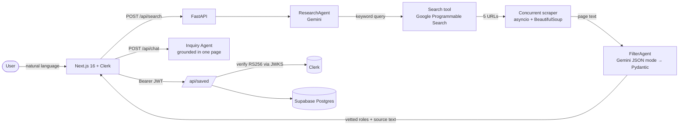

<p align="center">
  
</p>

<h1 align="center">Beacon</h1>

<p align="center">
  <b>An AI agent pipeline that finds, vets, and explains local volunteer opportunities across India.</b><br/>
  Describe how you want to help in plain English. Beacon searches trusted NGO sites, reads the pages,<br/>
  throws out the noise, and lets you ask follow-up questions grounded in the source page.
</p>

<p align="center">
  <a href="https://github.com/Justin-5/Beacon/actions/workflows/ci.yml"></a>
  
  
  
</p>

---

## The problem

People who want to volunteer have to dig through dozens of separate NGO sites, city portals, and national
programmes, most of which mix real openings with blogs, donation pages, and stale "About Us" copy.

## What Beacon does

1. **You type a request**, e.g. *"teaching kids on weekends in Bangalore"*.
2. **ResearchAgent** turns it into a keyword search query (shown to the user for transparency).
3. **Search tool** queries Google Programmable Search, restricted to a curated allow-list of Indian volunteer
   sites (`ivolunteer.in`, `bhumi.ngo`, `vidyanjali.education.gov.in`, ...), and **scrapes every result page concurrently**.
4. **FilterAgent** reads the scraped pages and returns only genuine, actionable roles as **schema-validated JSON**
   (Gemini structured output → Pydantic).
5. **Inquiry Agent** answers follow-up questions about a single role (*"What's the time commitment?"*) using
   **only that role's scraped page** (retrieval-grounded, and it says "not specified" instead of guessing).
6. Signed-in users can **save and remove** roles in a personal dashboard.

## Architecture



## Engineering highlights

- **Structured LLM output, not regex parsing.** The FilterAgent uses Gemini's JSON mode with a Pydantic
  response schema, so the API never ships malformed results. The extraction schema deliberately omits the
  scraped text, which keeps the model from echoing ~2 KB per result back as output tokens; the backend
  re-attaches the source text by URL afterwards.
- **Grounded follow-up chat.** Each role carries its scraped source text, and the Inquiry Agent is restricted to
  it. Scraped content is treated as untrusted data in every prompt (basic prompt-injection hygiene).
- **Fully async pipeline.** Native async Gemini client, and result pages are fetched in parallel with
  `asyncio.gather`, so scraping costs roughly the slowest page instead of the sum of all five.
- **Real authentication.** The backend verifies Clerk session JWTs (RS256, JWKS, expiry) and takes the user ID
  from the token, never from the request body, so users can only read and delete their own saved roles.
- **Production hygiene.** Input length limits at the API boundary, a global error handler that logs details
  server-side and returns a generic message (with CORS headers intact), configurable CORS origins,
  and API keys sent in headers so they never appear in logged URLs.
- **Tested and CI-checked.** Pytest suite covering the agent pipeline (with LLM and search stubbed), auth
  (missing, malformed, expired, and forged tokens), and error handling; GitHub Actions runs the tests plus
  frontend lint and typecheck on every push.

## Tech stack

| Layer    | Tech |
|----------|------|
| Frontend | Next.js 16 (App Router), React 19, TypeScript, Tailwind CSS 4, Framer Motion, Clerk |
| Backend  | Python 3.12, FastAPI, Pydantic v2, `google-genai` (Gemini 2.5 Flash-Lite), BeautifulSoup |
| Data     | Supabase (Postgres) |
| Auth     | Clerk (frontend sessions) + PyJWT verification on the API |
| Quality  | Pytest, ESLint, `tsc`, GitHub Actions |

## API

| Method   | Endpoint             | Auth   | Description |
|----------|----------------------|--------|-------------|
| `POST`   | `/api/search`        | none   | Run the agent pipeline for a natural-language request |
| `POST`   | `/api/chat`          | none   | Ask a grounded question about one role |
| `GET`    | `/api/saved`         | Bearer | List the signed-in user's saved roles |
| `POST`   | `/api/saved`         | Bearer | Save a role |
| `DELETE` | `/api/saved/{id}`    | Bearer | Remove a saved role |

Interactive docs are served at `http://localhost:8000/docs` when the backend is running.

## Running locally

**Prerequisites:** Python 3.12+, Node 20+, and keys for Gemini, Google Programmable Search, Supabase, and Clerk.

```bash
# 1. Backend
python -m venv .venv && source .venv/bin/activate   # Windows: .\.venv\Scripts\Activate.ps1
pip install -r requirements-dev.txt
cp .env.example .env                                 # fill in your keys
python -m backend.main                               # http://localhost:8000

# 2. Frontend (new terminal)
cd frontend
npm install
cp .env.example .env.local                           # fill in your keys
npm run dev                                          # http://localhost:3000

# 3. Tests
pytest
```

**Supabase table** (run once in the SQL editor):

```sql
create table saved_opportunities (
  id           bigint generated always as identity primary key,
  user_id      text not null,
  title        text,
  organization text,
  location     text,
  summary      text,
  url          text,
  full_text    text,
  created_at   timestamptz default now()
);
create index on saved_opportunities (user_id);
```

## Project structure

```
backend/
  main.py            FastAPI app, CORS, error handling
  api/routes.py      HTTP endpoints
  schemas/models.py  Pydantic request/response + LLM extraction schemas
  services/
    agents.py        ResearchAgent, FilterAgent, Inquiry Agent (Gemini)
    tools.py         Programmable Search + concurrent scraper
    auth.py          Clerk JWT verification
    db.py            Supabase persistence
frontend/src/
  app/               Home, search results, saved-roles dashboard
  components/        Hero, OpportunityCard, ChatDrawer
  lib/api.ts         Typed API client
tests/               Pytest suite
```

## Origin

Beacon started as my submission for a Google capstone project (a sequential multi-agent CLI and Streamlit app)
and was later rebuilt as a full-stack app with a FastAPI backend, a Next.js frontend, authentication, and persistence.
